# EV1527 · 433.92 MHz RF Link

An Arduino Uno generates a 24-bit EV1527-style baseband waveform, verified with a digital oscilloscope and logic analyser. The signal is transmitted via an FS1000A-class 433.92 MHz OOK transmitter, demodulated by an XD-RF-5V receiver, captured on an 8-channel 2 MHz logic analyser, and decoded in software and by hand. The transmitted code was then learned and actuated by a commercial 12 V learning relay receiver. Measured values are identified where applicable; calculated and nominal values are stated separately.

Detailed work log: [`docs/EV1527_Work_Log.md`](docs/EV1527_Work_Log.md) · Wiki: [EV1527 Baseband, RF Link, Decode and Relay](https://github.com/madhavkrishnanks/EV1527_RF_Link/wiki/EV1527-Baseband,-433.92-MHz-Link,-Decode-and-Relay)

---

## Hardware Setup

| Component | Model / Specification | Role in Experiment |
|---|---|---|
| **Microcontroller** | Arduino Uno (ATmega328P, 16 MHz, 5 V logic) | Baseband pattern generator (GPIO D8) |
| **Oscilloscope** | Rigol DS1054Z (50 MHz, 1 GSa/s, 10X probe) | Pulse width, amplitude, and duty-cycle verification |
| **RF Transmitter** | FS1000A-class (433.92 MHz SAW resonator, OOK/ASK) | Modulates D8 baseband onto 433.92 MHz RF carrier |
| **RF Receiver** | XD-RF-5V (433.92 MHz superregenerative receiver / demodulator) | Demodulates RF carrier to digital baseband (DATA pin) |
| **Logic Analyser** | 8-channel USB analyser (Saleae-compatible, 2 MHz) | Dual-channel digital capture of TX (D8) and RX (D7) |
| **Antennas** | 2 × 17.3 cm solid copper wire (quarter-wave wire whips) | Resonant elements for 433.92 MHz ($\lambda/4 \approx 17.28\ \text{cm}$) |
| **Relay Receiver** | 12 V single-channel learning receiver (Songle SRD-12VDC-SL-C) | EV1527 decoder and relay actuation target |
| **Handheld Remote** | 2-button commercial EV1527 key fob (Buttons A and B) | Reference hardware for frame and timing comparison |

| FS1000A TX & XD-RF-5V RX | 12 V Learning Relay Board | 2-Button Reference Remote |
|:---:|:---:|:---:|
| 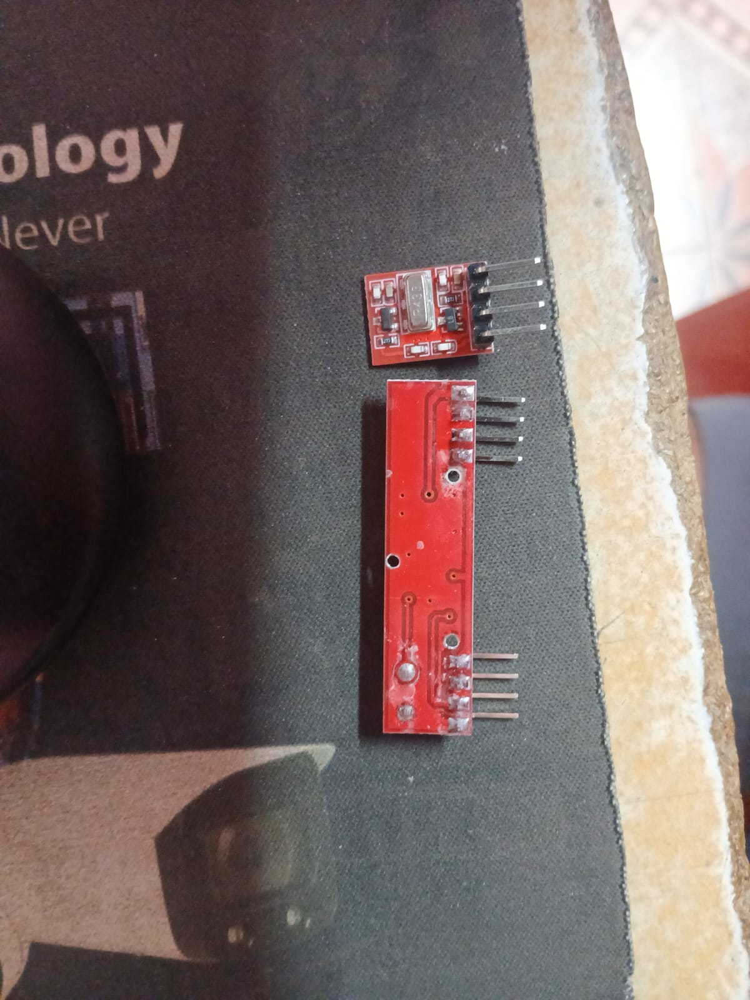<br><em>FS1000A TX and XD-RF-5V RX modules</em> | 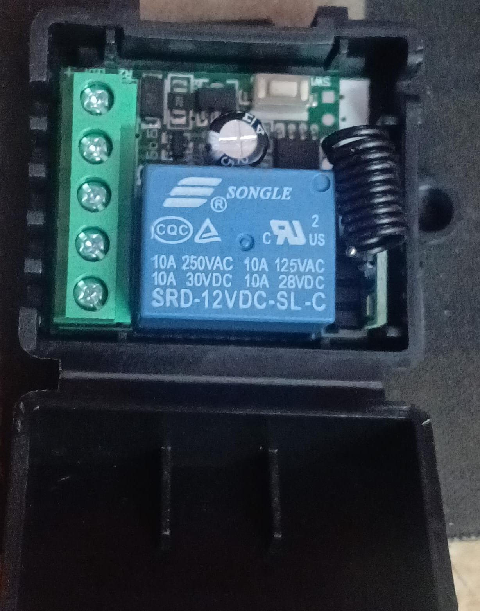<br><em>Songle SRD-12VDC-SL-C learning relay</em> | 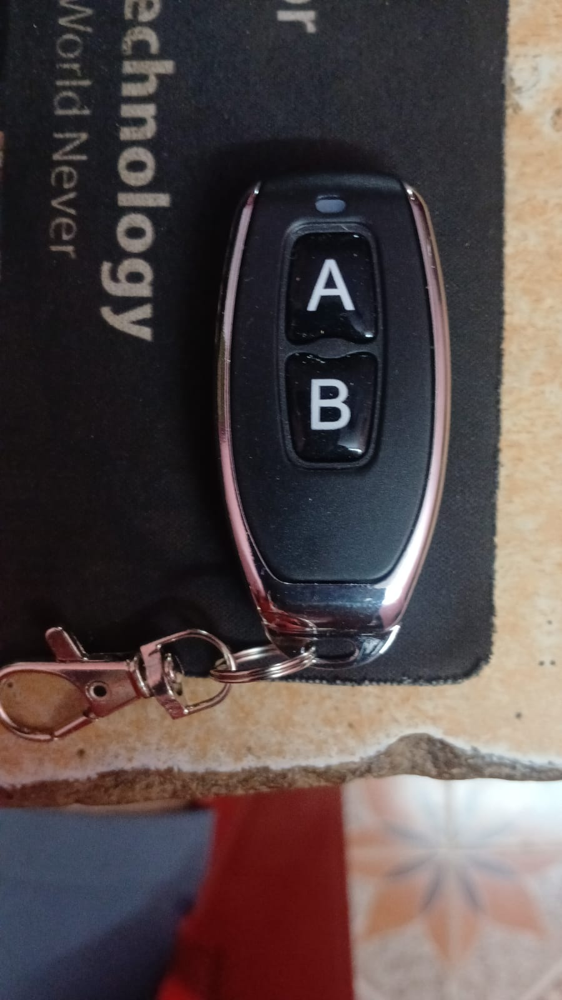<br><em>Two-button EV1527 reference key fob</em> |

---

## Signal Flow

```
Arduino Uno (D8) ─── Baseband ───► FS1000A TX (433.92 MHz OOK)
       │                                     │
   Scope CH1                               Air link (17.3 cm wire whips)
   LA Probe 0 ("TX_D8")                     │
                                            ▼
                              XD-RF-5V RX (DATA out)
                                     │
                        ┌────────────┴────────────┐
                        ▼                         ▼
             LA Probe 1 ("RX_D7")         12 V Learning Relay
             (Capture & Decode)           (Learn & Actuate)
```

---

## Protocol & Timing Structure

EV1527 encodes data using pulse-width modulation over On-Off Keying (OOK). Each frame consists of 25 pulses: 1 synchronization pulse and 24 data bits (20-bit address and 4-bit data), transmitted MSB first.

| Element | Level Encoding | Nominal Duration ($t = 250\ \mu\text{s}$) | Measured Value | Category |
|---|---|---|---|---|
| **Pulse unit ($t$)** | — | 250 µs | 250.0 µs (+Width on D8) | Measured |
| **Bit 0** | 1t HIGH, 3t LOW | 250 µs HIGH, 750 µs LOW | 250.0 µs HIGH, 770.0 µs LOW | Measured |
| **Bit 1** | 3t HIGH, 1t LOW | 750 µs HIGH, 250 µs LOW | 752–758 µs HIGH, 254–260 µs LOW | Measured |
| **Bit Period** | 4t total | 1000 µs (1.000 ms) | 1020 µs (1.020 ms) | Measured |
| **Sync Pulse** | 1t HIGH, 31t LOW | 250 µs HIGH, 7750 µs LOW | 252 µs HIGH, 7750 µs nominal | Measured / Nominal |
| **Active Frame Length** | 24 bits × 4t + 32t = 128t | 32.00 ms (nominal at $t = 250\ \mu\text{s}$) | ~32.25 ms (calculated from 1.020 ms bit period) | Calculated |
| **Inter-repeat Delay** | Firmware delay | 10.00 ms (`delay(10)`) | 10.00 ms | Implemented |
| **Total Post-sync Gap** | 31t LOW + 10 ms delay | 17.75 ms | 17.81 ms (17 810–17 816 µs) | Measured |
| **Frame Repetition Period** | Active frame (128t) + 10 ms delay | 42.00 ms nominal | ~42.4 ms | Measured |

*Note: The 20 µs excess on the LOW duration is caused by AVR `digitalWrite()` instruction overhead and `delayMicroseconds()` loop execution.*

| Bit Timing at 500 µs/div | 25 Pulses per Frame at 5 ms/div |
|:---:|:---:|
| 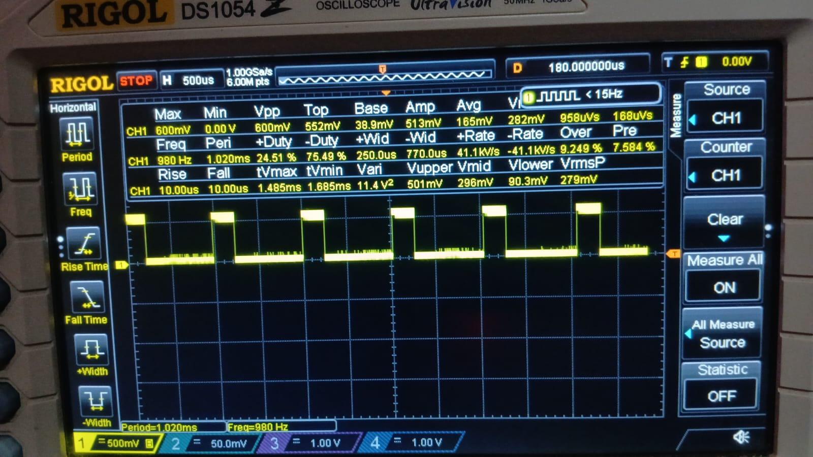<br><em>Scope CH1 on D8: +Width 250.0 µs, −Width 770.0 µs, Period 1.020 ms</em> | 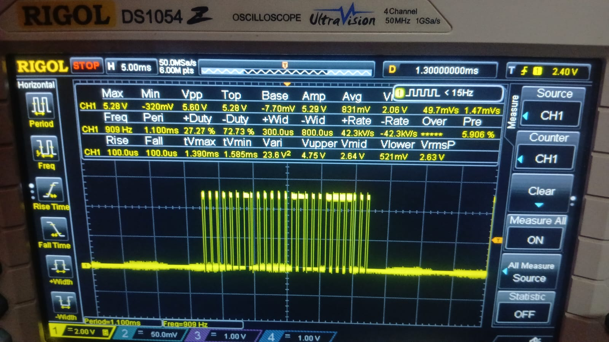<br><em>Scope CH1 on D8: 25 pulses per frame (1 sync + 24 data)</em> |

---

## Firmware & Framing Adaptation

The generator firmware is located at [`firmware/ev1527_generator.ino`](firmware/ev1527_generator.ino).

- **Data Word:** Defined as `0x3802063C`. The transmission loop extracts and sends the lower 24 bits (`0x02063C`), comprising 20-bit address `0x02063` and 4-bit data `1100` (`0xC`).
- **Bit Order:** Transmitted MSB first using `for (int i = 23; i >= 0; i--)`.
- **Framing Adaptation:** The task reference sketch (`reference/Arduino_EV1527_1.txt`) looped from bit 31 down to 0, transmitting 32 data pulses (33 total). As observed on the logic analyser below, adapting the loop to 24 bits restored standard 24-bit EV1527 framing (25 pulses total).
- **Burst Configuration:** Emits 4 repeated frames per burst with a 10 ms inter-repeat gap. For bench testing, `delay(1000)` pauses between bursts; for continuous link and relay actuation tests, this delay was removed.

| Reference Loop: 32 Data Bits (33 Pulses) | Adapted Loop: 24 Data Bits (25 Pulses) |
|:---:|:---:|
| 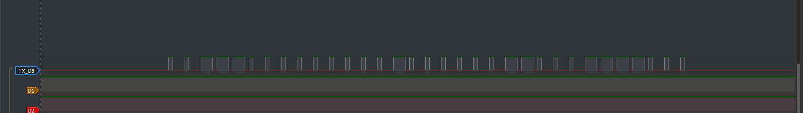<br><em>Reference code (`i = 31` down to 0): 32 data pulses per frame</em> | 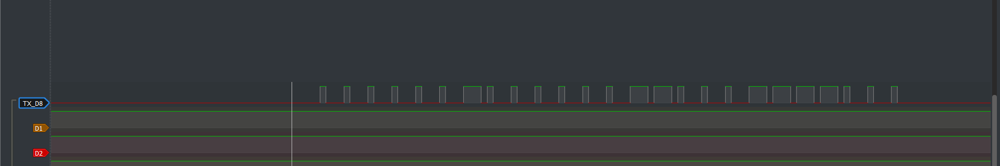<br><em>Adapted code (`i = 23` down to 0): 24 data + 1 sync pulse</em> |

---

## 433.92 MHz RF Link Verification

The D8 baseband was connected to the FS1000A transmitter DATA pin. The demodulated baseband from the XD-RF-5V receiver was captured alongside the transmitter output on an 8-channel USB logic analyser at 2 MHz (0.5 µs sample resolution).

<p align="center">
  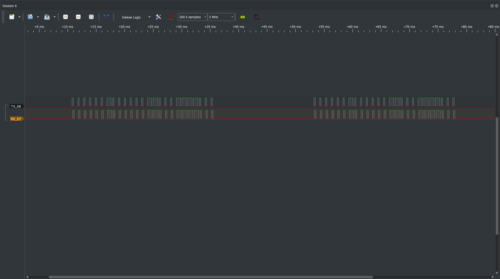<br>
  <em>Dual-channel capture (TX_D8 vs RX_D7) at 2 MHz over 100 ms: two complete frames, 25 pulses each on both channels</em>
</p>

<p align="center">
  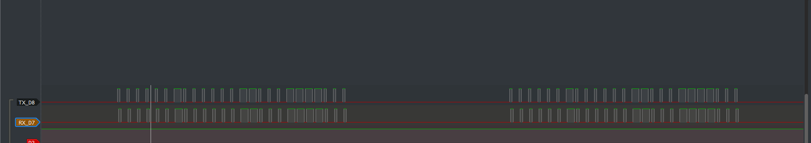<br>
  <em>Zoomed view: XD-RF-5V receiver reproduces the baseband pulse for pulse with ~25–30 µs latency and 25–35 µs HIGH pulse stretch</em>
</p>

### Receiver Demodulation Characteristics
- **Edge Latency:** The receiver output lagged the transmitter by approximately 25–30 µs in the captured setup.
- **Pulse Width Distortion:** The demodulator stretches HIGH pulses by 25–35 µs (Bit 0 HIGH stretches from 252 µs to 277–290 µs; Bit 1 HIGH stretches from 752–758 µs to 764–798 µs), correspondingly shortening the adjacent LOW pulse while preserving overall bit period (~1.020 ms).
- **Threshold Decoding:** Because pulse widths vary across the RF link, software decoders must evaluate pulse widths against a midpoint threshold (~500 µs) rather than exact nominal values.

---

## Commercial Remote Comparison

Transmissions from the commercial 2-button EV1527 key fob supplied with the relay board were captured on the XD-RF-5V receiver to compare timing and address encoding against the Arduino generator:

| Remote Button A: `0x613718` | Remote Button B: `0x613714` |
|:---:|:---:|
| 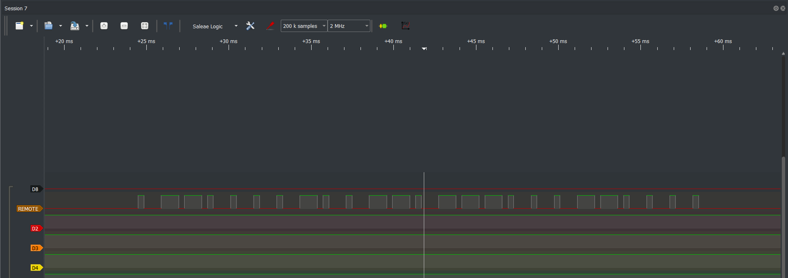<br><em>Button A: Address `0x61371`, Data `1000` (0x8), $t \approx 400\ \mu\text{s}$</em> | 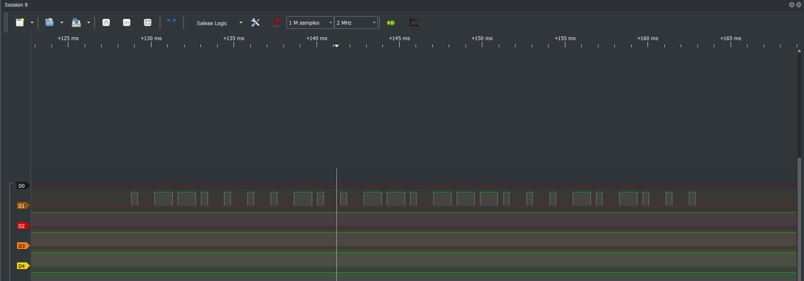<br><em>Button B: Address `0x61371`, Data `0100` (0x4), $t \approx 400\ \mu\text{s}$</em> |

| Parameter | Arduino Generator | Remote Button A | Remote Button B | Notes |
|---|---|---|---|---|
| **24-bit Word** | `0x02063C` | `0x613718` | `0x613714` | Verified across multiple runs |
| **Address ($C_{19} \dots C_0$)** | `0x02063` | `0x61371` | `0x61371` | Shared address between buttons A and B |
| **Data ($D_3 \dots D_0$)** | `1100` (`0xC`) | `1000` (`0x8`) | `0100` (`0x4`) | Button selection nibble |
| **Pulse Unit ($t$)** | 250 µs | $\approx 400\ \mu\text{s}$ | $\approx 400\ \mu\text{s}$ | Hardware RC oscillator variation |
| **Post-sync Gap** | 17.81 ms | 10.3–12.4 ms | 10.3–12.4 ms | Generator adds 10 ms inter-repeat delay |

The comparison confirms the protocol architecture: the 20-bit address identifies the transmitter device, while the 4-bit data field identifies the actuated button.

---

## Relay Actuation

The 12 V learning relay board (Songle SRD-12VDC-SL-C) was evaluated with both the commercial remote and the Arduino generator:

1. **Factory Pairing:** The board responded immediately to Remote Button A (`0x613718`).
2. **Learning Procedure:** The learning button was pressed on the relay board, and the Arduino transmitter broadcasting `0x02063C` was held ~30 cm away. The onboard indicator LED confirmed pairing, and the relay contacts switched.
3. **Transmission Interruption Test:** Disconnecting USB power stopped the generated transmission and the relay opened. Reconnecting power resumed transmission and the relay responded again.
4. **Operating Mode:** The relay operated in momentary mode with retriggering: repeated frames arriving every ~42 ms held the relay continuously closed without contact chatter between frames.

---

## Debugging & Instrumentation Findings

- **Sampling Aliasing:** Initial polling of receiver DATA with `digitalRead()` every 50 ms produced random binary values because the sample rate was far below the 1 kHz baseband. Resolved by using pulse-width timing and a 2 MHz logic analyser.
- **Probe Attenuation Mismatch:** Probing D8 initially showed 0.6 V logic HIGH instead of 5 V because the probe switch was set to 10X while oscilloscope CH1 attenuation was set to 1X. Correcting the scope menu setting restored 5.28 V amplitude reading.
- **Screen Buffer Quantisation:** Automatic width measurements at 10 ms/div quantised pulse widths to 200 µs display pixel boundaries ($10\ \text{ms} / 50\ \text{pixels/div} = 200\ \mu\text{s}$). Resolved by zooming horizontal timebase to 500 µs/div (10 µs/pixel) for pulse measurements.
- **Unsquelched Receiver Idle Noise:** When no 433 MHz carrier is present, the receiver's high-gain data slicer slices ambient thermal RF noise into random high-frequency transitions, as shown below. Adding resonant 17.3 cm antennas and transmitting continuously provided stable carrier recovery.

<p align="center">
  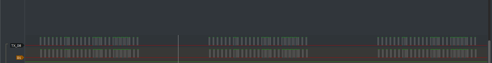<br>
  <em>Unsquelched receiver output when carrier is absent: high-gain data slicer toggles continuously on background thermal RF noise</em>
</p>

---

## Evidence & Verification Files

- **Complete Work Log:** [`docs/EV1527_Work_Log.md`](docs/EV1527_Work_Log.md) — Source-of-truth technical log with detailed timing tables.
- **Detailed Wiki Article:** [`docs/wiki/EV1527-Baseband-Link-Decode-Relay.md`](docs/wiki/EV1527-Baseband-Link-Decode-Relay.md) — 15-section detailed writeup.
- **Firmware:** [`firmware/ev1527_generator.ino`](firmware/ev1527_generator.ino) — 24-bit generator sketch.
- **Reference Sketch:** [`reference/Arduino_EV1527_1.txt`](reference/Arduino_EV1527_1.txt) — Original 32-bit reference code.
- **PulseView Captures:** [`captures/`](captures/) — Native `.sr` sessions (`RX_TX_of_both_boards.sr`, `tx_rx_run1.sr`, `tx_rx_run2.sr`, `tx_rx_run3.sr`, `remote_A.sr`, `remote_B.sr`).
- **Images:** [`images/`](images/) — Complete directory of 13 instrument captures and hardware photographs.

---

## Limitations

- **Benchtop Range:** Link tests were conducted at 0.5–1 m bench distance. Receiver sensitivity, multipath fading, and maximum RF range were not characterised.
- **RF Spectrum:** No RF spectrum analyser was available; carrier frequency accuracy, harmonic suppression, and transmit power were not measured.
- **Relay Power Cycle:** Memory persistence across a complete power disconnect of the 12 V relay board itself was not evaluated; re-actuation across transmitter power cycles was verified.
