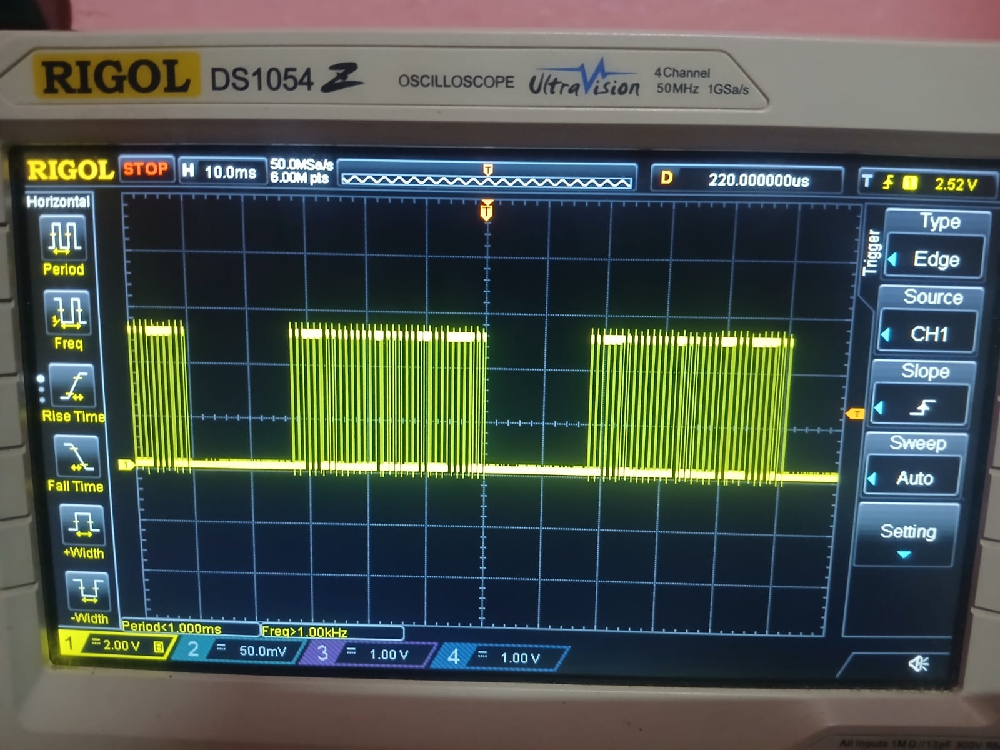

# EV1527 · 433.92 MHz RF Link — Generate, Verify, Decode, Actuate

An Arduino generates a 24-bit EV1527 frame, timing is verified on a Rigol oscilloscope, the frame travels over a 433.92 MHz OOK radio link, and a commercial learning relay responds to it. Every number here was measured. Five real faults were found and fixed along the way — including one in the task's own reference sketch.

**Full work log → [`docs/EV1527_Work_Log.md`](docs/EV1527_Work_Log.md) · Wiki → [EV1527 Baseband, RF Link, Decode and Relay](https://github.com/madhavkrishnanks/EV1527_RF_Link/wiki/EV1527-Baseband,-433.92-MHz-Link,-Decode-and-Relay)**

---

## Hardware

<p align="center">
  
  &nbsp;&nbsp;
  
</p>
<p align="center">
  <em>Left: FS1000A-class transmitter and XD-RF-5V receiver · Right: Songle SRD-12VDC-SL-C learning relay receiver</em>
</p>

<p align="center">
  
</p>
<p align="center">
  <em>Two-button EV1527 remote supplied with the relay board</em>
</p>

---

## Results at a Glance

| Quantity | Value |
|---|---|
| Pulse unit t | 250 µs |
| Bit 0 timing | 250 µs HIGH · 770 µs LOW |
| Bit 1 timing | 770 µs HIGH · 250 µs LOW |
| Bit period | 1.020 ms (4t) |
| Pulses per frame | 25 (1 sync + 24 data) |
| Transmitted word | `0x02063C` |
| Decoded word (TX and RX) | `0x02063C` — identical on both channels |
| Remote button A | `0x613718` · address `0x61371` · data `1000` |
| Remote button B | `0x613714` · address `0x61371` · data `0100` |
| Relay | operates from the generated frame |

---

## Signal Chain

```
Arduino Uno ── D8 ──┬── Rigol DS1054Z CH1       (timing, amplitude)
                    ├── logic analyser CH0       ("TX_D8")
                    └── FS1000A transmitter ── 433.92 MHz OOK ──┐
                                                                 │
EV1527 learning relay receiver ◄── XD-RF-5V receiver ◄──────────┘
         │                               │
     relay contact                DATA ──┴── Arduino D7 / analyser CH1 ("RX_D7")
```

---

## Oscilloscope — Timing Verification

<p align="center">
  
</p>
<p align="center">
  <em>CH1 on D8 · 500 µs/div · +Width 250.0 µs · −Width 770.0 µs · period 1.020 ms</em>
</p>

The DS1054Z auto-measure at 500 µs/div gives the pulse widths directly. At coarser timebases the readings are pixel-quantised (200 µs resolution) and cannot be trusted — a fault documented in the work log.

<p align="center">
  
  &nbsp;&nbsp;
  
</p>
<p align="center">
  <em>Left: 10 ms/div — frame bursts with sync gap visible · Right: 5 ms/div — 25 pulses in one complete frame</em>
</p>

---

## Logic Analyser — Before and After the Fix

The task's reference sketch transmits a 32-bit loop, producing 33 pulses per frame instead of 25. The fix is a single-line change: `for (int i = 23; ...)`.

<p align="center">
  
  &nbsp;&nbsp;
  
</p>
<p align="center">
  <em>Left: 33 pulses (32 data + 1 sync) before the fix · Right: 25 pulses (24 data + 1 sync) after</em>
</p>

---

## RF Link — TX and RX on Two Channels

<p align="center">
  
</p>
<p align="center">
  <em>TX_D8 and RX_D7 · 2 MHz · 100 ms window · two complete frames · 25 pulses each on both channels</em>
</p>

<p align="center">
  
</p>
<p align="center">
  <em>Same capture zoomed — the receiver reproduces the frame pulse for pulse, with ~25–30 µs edge lag</em>
</p>

The receiver stretches each HIGH by roughly 25–35 µs. That is normal for a superheterodyne module with AGC. The decode is `0x02063C` on both channels.

---

## Remote Frames — The Two Decoded Words

The remote was captured live (transmitter silenced) and each button decoded from the raw waveform.

<p align="center">
  
  &nbsp;&nbsp;
  
</p>
<p align="center">
  <em>Left: button A · `0x613718` · data nibble `1000` · Right: button B · `0x613714` · data nibble `0100`</em>
</p>

| Source | 24-bit word | Address (C19..C0) | Data (D3..D0) |
|---|---|---|---|
| Arduino, generated | `0x02063C` | `0x02063` | `1100` |
| Remote, button A | `0x613718` | `0x61371` | `1000` |
| Remote, button B | `0x613714` | `0x61371` | `0100` |

The address is identical across both remote buttons. Only the 4-bit data field changes — the 20 + 4 packet structure confirmed by measurement, not assumed.

Button B was captured five consecutive times in one session (`captures/remote_B.sr`). All five frames decoded to `0x613714`. Button A was confirmed in `captures/remote_A.sr`.

---

## Receiver Idle — What Noise Looks Like

<p align="center">
  
</p>
<p align="center">
  <em>Receiver output with no carrier present — dense oscillation, not a frame. Antennas and a live transmitter are both required.</em>
</p>

---

## Protocol

EV1527 is fixed-code OOK. One frame is 25 pulses — 24 data bits MSB first (20-bit address + 4-bit data) plus a sync pulse. Every bit occupies exactly 4t, so frame length is constant at 128t.

| Element | HIGH | LOW | At t = 250 µs |
|---|---|---|---|
| sync | 1t | 31t | 250 µs / 7750 µs |
| bit 0 | 1t | 3t | 250 µs / 750 µs |
| bit 1 | 3t | 1t | 750 µs / 250 µs |

The firmware emits: **24 data bits → sync → 10 ms gap**, then repeats. The post-sync gap measures 17.8 ms (31t + 10 ms), against the reference remote's 10.3–12.4 ms. The relay accepts it. A decoder that validates the gap against 31t ± 20 % may not. One-line fix documented in §4.1 of the work log.

---

## Reproducing It

1. Flash `firmware/ev1527_generator.ino` onto an Arduino Uno (output on D8).
2. Scope CH1 on D8 — 10X probe **and** 10X in the channel menu. Use 500 µs/div for pulse widths, 10 ms/div for frame structure, rising-edge trigger at ~1.5 V.
3. Wire transmitter DATA to D8, receiver DATA to the analyser. Fit a 17.3 cm wire on each ANT pad. Keep boards 0.5–1 m apart.
4. Capture at 2 MHz. Find the frame boundary at the long LOW, then read each HIGH: over 500 µs is a 1.
5. For the relay: 12 V to the board, put it in learn mode, transmit from the Arduino.

Native PulseView captures are in `captures/` — reopen any of them and re-derive every timing independently.

---

## Five Faults Found by Measurement

| Fault | How it showed up | Fix |
|---|---|---|
| 32-bit loop in the reference sketch | 33 pulses per frame, not 25 | Loop `i = 23`, send low 24 bits |
| 10X probe, 1X channel setting | 5 V logic read as 0.6 V | Set probe attenuation in CH1 menu |
| Auto-measurements pixel-quantised | `+Wid 200 µs` at 10 ms/div | Measure at 500 µs/div or use cursors |
| Sampling a 1 ms signal every 50 ms | Random 1/0 stream, 60 % ones | Measure widths, not levels |
| One board cannot TX and RX at once | Every early receive test decoded noise | Capture with analyser while generator runs |

---

## Repository Contents

| Path | Contents |
|---|---|
| `firmware/ev1527_generator.ino` | bit-banged generator, t = 250 µs, 24 bits |
| `reference/Arduino_EV1527_1.txt` | task reference sketch — 32-bit loop, unmodified |
| `captures/RX_TX_of_both_boards.sr` | sigrok session, 2 MHz, 200 000 samples, TX + RX |
| `captures/tx_rx_run1,2,3.sr` | three RF-link capture runs (run3 has the single-bit error) |
| `captures/remote_A.sr` / `remote_B.sr` | remote button A and B captures |
| `docs/EV1527_Work_Log.md` | full work log — method, measurements, defects, status |
| `images/` | 13 scope and analyser captures + hardware photographs |

---

## Limitations

- No photograph or video of the relay stage was taken. The result is recorded in writing in §7 of the work log.
- Pairing persistence across a power cycle of the relay board itself was not separately verified.
- Range was not characterised; the link was tested at bench distances.
- The PulseView built-in OOK decoder is Manchester-based and does not apply to EV1527 pulse-width coding.

---

## Reference

Task: Sanjeeb Mishra, Task-Based Learning Cohort 2 — *EV1527 waveform pattern generation using AFG and Arduino*.
[github.com/SanjeebMishra/TaskBasedLearningCohort1/wiki/Task-Based-Learning-Cohort-2](https://github.com/SanjeebMishra/TaskBasedLearningCohort1/wiki/Task-Based-Learning-Cohort-2)

K.S. Madhavkrishnan · November 2026
